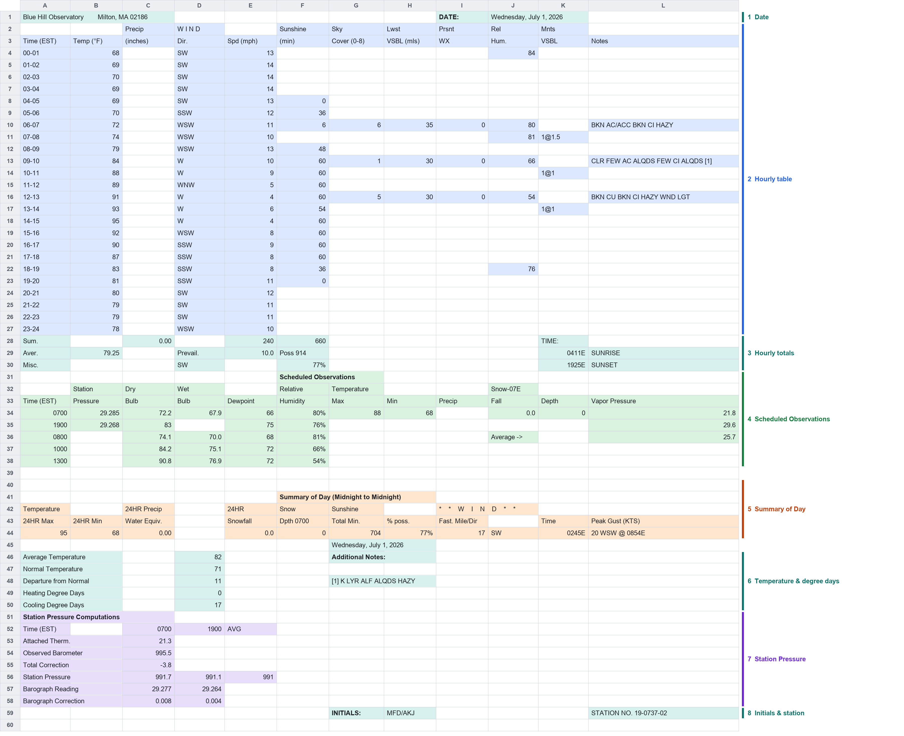
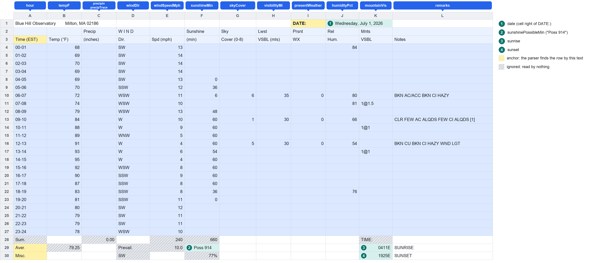
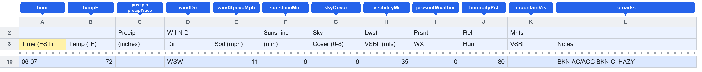
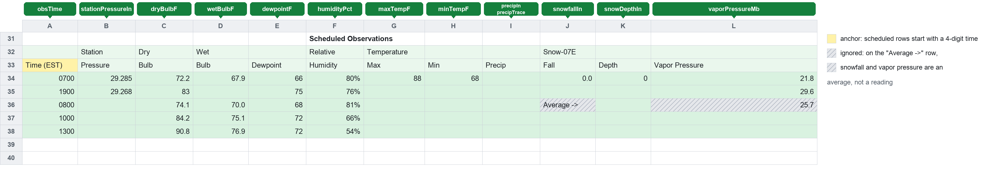
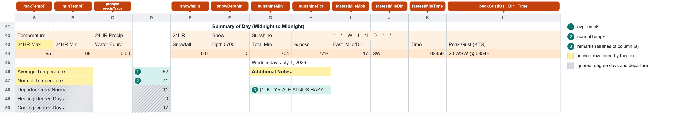
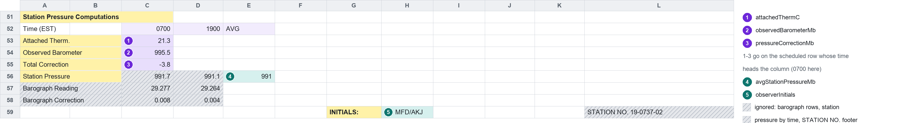

# Daily sheet parser

Turns the staff **daily observation sheet** (exported as CSV) into typed rows
ready for the database. One file holds a whole month: one block per day.

```ts
import { parseDaily } from './daily';

const result = parseDaily(csvText);
if (result.ok === false) {
  // result.errors: [{ row: 10, column: 'Temp (°F)', reason: 'Expected a whole number, got "x"' }, ...]
} else {
  // result.rows: one ParsedDay per day: { daily, hourly[], scheduled[] }
}
```

- It never stops at the first problem. It collects every error so staff can fix
  the whole file in one upload. Errors carry the **1-based sheet row** and the
  **column header as printed on the sheet**.
- It returns either all rows or all errors, never a partial result.
- The output types (`ParsedDay`, `DailyObservation`, `HourlyObservation`,
  `ScheduledObservation`) live in `libs/weather-parsing/src/types.ts`. Every
  field has the **same name as its database column**, so there is no
  renaming layer to learn.

## How to read this README

It goes from what you see in the spreadsheet to the code:

1. [The whole day](#1-the-whole-day) – the sheet as staff fill it in, cut into regions.
2. [Hourly table](#2-hourly-table) → [one row, cell by cell](#one-row-cell-by-cell).
3. [Scheduled observations](#3-scheduled-observations).
4. [Summary of day](#4-summary-of-day).
5. [Station pressure and footer](#5-station-pressure-and-footer).
6. [Format rules](#format-rules), [units](#units), [ignored cells](#cells-the-parser-ignores), [errors](#errors).
7. [Where the code is](#where-the-code-is) and [how to change it](#working-on-it).

All pictures are drawn from the real July 1, 2026 block of the test fixture,
using the parser's own column map. **Row numbers on the left are the real sheet
rows**, so they match the `row` in an error message (for the first day of the
file; later days are 60 rows further down each).

### How to read the pictures

| Marking | Meaning |
| --- | --- |
| Colored cells | The parser reads these. The color is the region (blue hourly, green scheduled, orange summary, purple pressure, teal other cells). |
| **Colored tag above a column** | The field that column becomes (`tempF`, `windDir`, …). |
| **Numbered circle on a cell** | A single cell that becomes one field; the number is explained in the legend beside the picture. |
| Yellow cell | **Anchor**: the parser finds the row by this exact text (`DATE:`, `Aver.`, `24HR Max`, …). It is never read as a value. |
| Grey hatching | **Ignored**: nothing reads this cell. See [Cells the parser ignores](#cells-the-parser-ignores). |
| Column letters `A`…`L` | The spreadsheet's columns. `layout.ts` uses the same positions (A = 0). |

## 1. The whole day



This is one day. A file is 28–31 of these stacked one under another. The regions:

| # | Region | Rows (day 1) | Becomes |
| --- | --- | --- | --- |
| 1 | Date | 1 | `date` on everything below |
| 2 | Hourly table | 2–27 | 24 × `HourlyObservation` |
| 3 | Hourly totals (`Sum.`, `Aver.`, `Misc.`) | 28–30 | three cells: possible sunshine, sunrise, sunset |
| 4 | Scheduled Observations | 31–38 | `ScheduledObservation` per time (0700, 1900, …) |
| 5 | Summary of Day | 41–44 | most of `DailyObservation` |
| 6 | Temperature and degree days, notes | 45–50 | average and normal temperature, `remarks` |
| 7 | Station Pressure Computations | 51–58 | pressure fields on the scheduled rows, average station pressure |
| 8 | Initials and station | 59 | `observerInitials` |

**How a day block is found.** Every row containing the cell `DATE:` starts a
day. The date is the cell to its right (`Wednesday, July 1, 2026` becomes
`2026-07-01`). A day runs to the row before the next `DATE:` (or the end of the
file). Inside a block, rows are found **by their text, never by row number**, so
a day block can sit on any row. Columns are fixed positions. All cells are
trimmed first, because the sheet pads labels (`DATE: `).

The sections below zoom into each region.

## 2. Hourly table

Region 2 is the biggest: 24 rows, one per hour. Region 1 (the date) and region 3
(the three cells under the table) are in the same picture.



- Column A is the **key**: `00-01` is the hour starting at midnight, so `hour` = `0`.
  `05-06` is `5`. A row must be `HH-HH+1`; `05-07` is an error, and so is a repeated hour.
- Every other column becomes the field named in the tag above it.
- The `Sum.` row and the hourly average temperature (`79.25`) are hatched grey:
  **ignored**.
- Three cells under the table are single values: **2** `sunshinePossibleMin`
  (`Poss 914` → `914`), **3** `sunrise` (`0411E` → `04:11`), **4** `sunset`.
  They go on the *day's* record, not on an hourly row.

| Col | Sheet header | Field | Type | Notes |
| --- | --- | --- | --- | --- |
| A | Time (EST) | `hour` | number | `00-01` → `0`. |
| B | Temp (°F) | `tempF` | number | Whole degrees. |
| C | Precip (inches) | `precipIn`, `precipTrace` | string, boolean | `T` → `precipIn` null, `precipTrace` true. |
| D | Wind Dir. | `windDir` | string | Compass point, uppercased (`SW`, `WSW`). |
| E | Wind Spd (mph) | `windSpeedMph` | number | ≥ 0. **mph.** |
| F | Sunshine (min) | `sunshineMin` | number | 0 to 60. |
| G | Sky Cover (0-8) | `skyCover` | number | 0 to 8 (eighths). |
| H | Lwst VSBL (mls) | `visibilityMi` | string | `1/8` → `"0.125"`, `1 1/2` → `"1.5"`. |
| I | Prsnt WX | `presentWeather` | string | Kept as text; `0` means observed, no weather. |
| J | Rel. Hum. | `humidityPct` | number | 0 to 100. |
| K | Mnts VSBL | `mountainVis` | string | Kept as text, e.g. `1@1.5`. |
| L | Notes | `remarks` | string | Free text. |

### One row, cell by cell

Take the `06-07` row (sheet row 10). This is the whole path from the cell staff
type to the value in the database:



| Cell | You typed | Field | Parsed value | Why |
| --- | --- | --- | --- | --- |
| A10 | `06-07` | `hour` | `6` | The hour the range starts. |
| B10 | `72` | `tempF` | `72` | Integer. |
| C10 | *(blank)* | `precipIn`, `precipTrace` | `null`, `false` | Blank is **not** 0. |
| D10 | `WSW` | `windDir` | `"WSW"` | A valid compass point. |
| E10 | `11` | `windSpeedMph` | `11` | |
| F10 | `6` | `sunshineMin` | `6` | Within 0–60. |
| G10 | `6` | `skyCover` | `6` | Within 0–8. |
| H10 | `35` | `visibilityMi` | `"35"` | Decimals stay strings, to keep every digit. |
| I10 | `0` | `presentWeather` | `"0"` | Text, not a number. |
| J10 | `80` | `humidityPct` | `80` | |
| K10 | *(blank)* | `mountainVis` | `null` | |
| L10 | `BKN AC/ACC BKN CI HAZY` | `remarks` | `"BKN AC/ACC BKN CI HAZY"` | |

The complete result for that row:

```json
{
  "date": "2026-07-01", "hour": 6, "tempF": 72,
  "precipIn": null, "precipTrace": false,
  "windDir": "WSW", "windSpeedMph": 11, "sunshineMin": 6, "skyCover": 6,
  "visibilityMi": "35", "presentWeather": "0", "humidityPct": 80,
  "mountainVis": null, "remarks": "BKN AC/ACC BKN CI HAZY"
}
```

If a cell is wrong, say `E10` holds `x`, the error is
`{ row: 10, column: "Wind Spd (mph)", reason: 'Expected a whole number, got "x"' }`:
the sheet row, plus the header as printed.

## 3. Scheduled observations

Region 4: readings taken at set times. One `ScheduledObservation` per row.



- A row counts as a scheduled row when column A is a **4-digit time**
  (`0700`, `1900`, `1300`). `0700` becomes `obsTime` `07:00`. Times are unique per day.
- Humidity can be `80%` or `0.80`: both are `80`.
- The `Average ->` row (row 36) is hatched: the label sits under Snow Fall, and
  the number under Vapor Pressure is an **average, not a reading**, so those two
  cells are skipped. The rest of the row (dry bulb, wet bulb, dewpoint,
  humidity) is read as usual.

| Col | Sheet header | Field | Type | Notes |
| --- | --- | --- | --- | --- |
| A | Time (EST) | `obsTime` | string | `HH:MM`. |
| B | Station Pressure | `stationPressureIn` | string | **Inches.** |
| C | Dry Bulb | `dryBulbF` | string | Decimal °F. |
| D | Wet Bulb | `wetBulbF` | string | Decimal °F. |
| E | Dewpoint | `dewpointF` | number | Whole °F. |
| F | Relative Humidity | `humidityPct` | number | `80%` or `0.80` → `80`. |
| G | Max | `maxTempF` | number | |
| H | Min | `minTempF` | number | |
| I | Precip | `precipIn`, `precipTrace` | string, boolean | `T` = trace. |
| J | Snow Fall | `snowfallIn` | string | Null on the `Average ->` row. |
| K | Snow Depth | `snowDepthIn` | string | |
| L | Vapor Pressure | `vaporPressureMb` | string | Null on the `Average ->` row. |

**Three more fields come from region 7** (the pressure block, section 5). They
are added to the scheduled row **with the same time**: the `0700` row gets the
`0700` column of the block. So the full `0700` result mixes both places:

```jsonc
{
  "date": "2026-07-01", "obsTime": "07:00",
  "stationPressureIn": "29.285",              // row 34, column B
  "attachedThermC": "21.3",                   // row 53, column C   (pressure block)
  "observedBarometerMb": "995.5",             // row 54, column C   (pressure block)
  "pressureCorrectionMb": "-3.8",             // row 55, column C   (pressure block)
  "dryBulbF": "72.2", "wetBulbF": "67.9", "dewpointF": 66, "humidityPct": 80,
  "maxTempF": 88, "minTempF": 68,
  "precipIn": null, "precipTrace": false,
  "snowfallIn": "0.0", "snowDepthIn": "0",
  "vaporPressureMb": "21.8"
}
```

Rows come back sorted by `obsTime`. A time that appears **only** in the
pressure block (for example `1200`) still gets a scheduled row, with every other
field null.

## 4. Summary of day

Regions 5 and 6: the day's totals, then a few cells below and beside them.



- The values are on the row **below** the `24HR Max` header: row 44. The tags
  above the columns show what each becomes. The wind banner (`* * W I N D * *`)
  is only a label.
- The **Peak Gust** cell is one cell with three values:
  `20 WSW @ 0854E` → `peakGustKts` `20`, `peakGustDir` `WSW`,
  `peakGustTime` `08:54`. If several times are listed, the first is kept.
- **1** `avgTempF` and **2** `normalTempF` are in column D, found by the row
  label in column A.
- **3** `remarks`: every non-empty line of column G between `Additional Notes:` and
  `INITIALS:`, joined with a newline.
- `Departure from Normal`, `Heating Degree Days` and `Cooling Degree Days` are
  hatched: **ignored**.

| Col | Sheet header | Field | Type | Notes |
| --- | --- | --- | --- | --- |
| A | 24HR Max | `maxTempF` | number | |
| B | 24HR Min | `minTempF` | number | |
| C | Water Equiv. | `precipIn`, `precipTrace` | string, boolean | `T` = trace. |
| E | Snowfall | `snowfallIn` | string | |
| F | Dpth 0700 | `snowDepthIn` | string | |
| G | Total Min. | `sunshineMin` | number | ≥ 0. |
| H | % poss. | `sunshinePct` | number | `77%` or `0.77` → `77`. |
| I | Fast. Mile | `fastestMileMph` | number | ≥ 0. **mph.** |
| J | Fast. Mile Dir | `fastestMileDir` | string | Compass point. |
| K | Time | `fastestMileTime` | string | `0245E` → `02:45`. |
| L | Peak Gust (KTS) | `peakGustKts`, `peakGustDir`, `peakGustTime` | number, string, string | **Knots.** |

## 5. Station pressure and footer

Regions 7 and 8.



- The block's **times** are in row 52 (`0700`, `1900`, `AVG`, sometimes `1200E`),
  starting at column C. The numbered cells **1–3** are read from the column of
  each time and go onto the scheduled row with that time (section 3).
- **4** `avgStationPressureMb`: the `AVG` column of the `Station Pressure` row
  (row 56). The per-time pressures beside it (`991.7`, `991.1`) are ignored. The
  scheduled rows carry station pressure in inches instead.
- **5** `observerInitials`: the cell right of `INITIALS:`.
- The barograph rows and the `STATION NO.` footer are ignored.

| Where | Field | Notes |
| --- | --- | --- |
| `Attached Therm.` row, under each time | `attachedThermC` | °C. |
| `Observed Barometer` row, under each time | `observedBarometerMb` | mb. |
| `Total Correction` row, under each time | `pressureCorrectionMb` | mb. |
| `Station Pressure` row, col E (`AVG`) | `avgStationPressureMb` | Decimal string, mb. |
| Cell right of `INITIALS:` | `observerInitials` | `MFD/AKJ`. |

### Other single cells that feed the day record

| Where | Field | Notes |
| --- | --- | --- |
| `DATE:` row, cell to the right | `date` | `Wednesday, July 1, 2026` → `2026-07-01`. Must be a real date. |
| `Aver.` row, col F | `sunshinePossibleMin` | `Poss 914` → `914`. |
| `Aver.` row, col K | `sunrise` | `0411E` → `04:11`. |
| `Misc.` row, col K | `sunset` | `1925E` → `19:25`. |
| `Average Temperature` row, col D | `avgTempF` | Decimal string. |
| `Normal Temperature` row, col D | `normalTempF` | Whole degrees. |

The complete day record for July 1:

```json
{
  "date": "2026-07-01",
  "maxTempF": 95, "minTempF": 68, "avgTempF": "82", "normalTempF": 71,
  "precipIn": "0.00", "precipTrace": false, "snowfallIn": "0.0", "snowDepthIn": "0",
  "sunshineMin": 704, "sunshinePossibleMin": 914, "sunshinePct": 77,
  "fastestMileMph": 17, "fastestMileDir": "SW", "fastestMileTime": "02:45",
  "peakGustKts": 20, "peakGustDir": "WSW", "peakGustTime": "08:54",
  "avgStationPressureMb": "991", "sunrise": "04:11", "sunset": "19:25",
  "observerInitials": "MFD/AKJ", "remarks": "[1] K LYR ALF ALQDS HAZY"
}
```

## Format rules

These apply to every cell, through the readers in `cells.ts`.

| Rule | Example |
| --- | --- |
| **Blank cell → `null`.** Never `0`. A real `0` stays `0`. | `` → `null`, `0` → `0` |
| Trailing `*` is a footnote marker and is dropped. | `14*` → `14` |
| Decimals stay **strings**, so no precision is lost (matches how Postgres returns `numeric`). | `29.285` → `"29.285"` |
| Integers are numbers. | `68` → `68` |
| `T` in a precip cell is a trace. | `T` → `precipTrace: true` |
| Percentages accept `77%` or a fraction. | `77%`, `0.77` → `77` |
| Fractions in visibility. | `1/8` → `"0.125"` |
| Times accept `HHMM` with an optional `E` (EST) and are returned as `HH:MM`. Hours 0–23, minutes 0–59. | `0245E` → `02:45` |
| Directions are the 16 compass points, uppercased. | `wsw` → `WSW` |

**The parser reads the CSV as exported, which is what the cells *display*.** The
sheet stores times like `0700` and percentages like `80%` as numbers with a
display format, and the CSV export writes the formatted text. A cell that
*shows* `82` but holds `81.5` is exported as `82`, so `avgTempF` is `"82"` and
the half degree is lost before the parser sees it. If that matters, widen the
cell's display format on the sheet.

## Units

The sheet mixes units, and the parser keeps what the sheet prints. It does **no
conversion**:

| Field | Unit |
| --- | --- |
| `windSpeedMph`, `fastestMileMph` | mph |
| `peakGustKts` | **knots** (the sheet header says `KTS`) |
| `stationPressureIn` | inches of mercury |
| `avgStationPressureMb`, `observedBarometerMb`, `pressureCorrectionMb`, `vaporPressureMb` | millibars |
| `attachedThermC` | °C |
| `*TempF`, `dryBulbF`, `wetBulbF`, `dewpointF` | °F |
| `precipIn`, `snowfallIn`, `snowDepthIn` | inches |
| `visibilityMi` | miles |

Times are EST. The trailing `E` on the sheet is stripped and nothing else is
done with it.

## Cells the parser ignores

On purpose, so a gap is a decision and not an accident (the grey hatching above):

- The **`Sum.`** row under the hourly table (precip, wind speed and sunshine totals) and the `TIME:` label.
- The hourly **average temperature** (`79.25`) on the `Aver.` row, plus `Prevail.` and the `10.0` average wind speed. The
  `avgTempF` field comes from the `Average Temperature` cell instead.
- The **prevailing wind** (`SW`) and the percentage on the `Misc.` row.
- **`Departure from Normal`**, **`Heating Degree Days`** and **`Cooling Degree Days`**.
- The per-time **`Station Pressure`** values (`991.7`, `991.1`) and the **Barograph Reading** and **Barograph Correction** rows.
- The **`STATION NO.`** footer. The parser does not check which station a file belongs to.
- The page title in A1, and the `Scheduled Observations` / `Summary of Day` titles.

If you need one of these, add it to `layout.ts`, a section parser and the types
(see below), and move its line out of this list.

## Errors

Each error is `{ row?, column?, reason }`. `row` is the 1-based sheet row; it is
absent when the whole file is at fault.

| Reason | Meaning and fix |
| --- | --- |
| `No "DATE:" row` | No day block was found. Wrong file, or the `DATE:` cell was deleted. |
| `No "<label>" row` | A row the parser needs is missing from a day (reported on that day's `DATE:` row). Restore the row; do not rename its label. |
| `Expected a date like "Wednesday, July 1, 2026", got …` | The date is missing, misspelled, or not a real calendar date (`June 31`). |
| `<date> is also on row N` | The same date appears twice in one file. |
| `Expected a whole number, got "x"` / `Expected a number, got "x"` | A cell holds text where a number belongs. |
| `Expected N to M, got X` / `Expected at least N, got X` | A number is out of range (sky cover 9, sunshine 75). |
| `Expected 0% to 100%, got X%` | A percentage is above 100. |
| `Expected a percentage, got "x"` | Not `77%` or `0.77`. |
| `Expected a distance like "35" or "1/8", got "x"` | Visibility is not a number or fraction. |
| `Expected a compass direction, got "x"` | Not one of the 16 compass points. |
| `Expected a time like "0245E", got "x"` | Not a valid `HHMM` (`2560`). |
| `Expected a gust like "20 WSW @ 0854E", got "x"` | The peak gust does not match `<kts> <dir> @ <time>`. |
| `Not a compass direction: "x"` | The direction inside a peak gust is invalid. |
| `Expected an hour like "05-06", got "05-07"` | An hourly row's label is not a one-hour range. |
| `<key> is also on row N` | An hour (`05-06`) or scheduled time repeats within a day. |
| `Not a time of day: "2560"` | A scheduled row's time is not a valid time. |
| `Expected a value like "Poss 914", got "x"` | The possible-sunshine cell has the wrong shape. |

## Where the code is

Read in this order:

| File | What it does |
| --- | --- |
| `index.ts` | Entry point. Splits the file into day blocks, parses each, checks for repeated dates. |
| `sheet.ts` | `Day`: a helper scoped to one day block (`find`, `require`, `rows`, `unique`). |
| `hourly.ts` | Section 2: one `HourlyObservation` per `00-01` … `23-24` row. |
| `scheduled.ts` | Sections 3 and 5: scheduled rows plus the pressure block. |
| `summary.ts` | Section 4: Summary of Day and the cells around it, one `DailyObservation`. |
| `layout.ts` | **Every sheet position and label** (the columns in the tables above). The one place that knows where a cell is. |
| `cells.ts` | Typed cell readers (`int`, `dec`, `pct`, `time`, …) and the format rules. |

The CSV reader itself (quotes, commas, CRLF) is `../csv.ts`, shared with the
historical parser.

## Working on it

Run the tests (from the repo root):

```
npx nx test upload-lambda
```

- Tests are in `../daily.test.ts`. They run on `../__fixtures__/daily.csv`,
  an export of the July 2026 sheet: 31 day blocks of 60 rows each.
- Most tests take July 1 (rows 1–60), edit one cell, and check the field or error.
  The helper `edit(table, row, col, value)` sets a cell by 1-based row and 0-based column.

**Try a real CSV and see the JSON.** From `apps/backend/upload-lambda`:

```
yarn parse:daily                                  # uses src/parsers/__fixtures__/daily.csv
yarn parse:daily path/to/export.csv               # your own file
yarn parse:daily path/to/export.csv path/to/out   # and your own output folder
```

It writes one file per day, named by date, to `output/daily/` (git-ignored):
`2026-07-01.json`, `2026-07-02.json`, … each holding that day's
`{ daily, hourly, scheduled }`. The folder's `*.json` files are cleared on each
successful run, so it only shows the last file you ran. If the CSV has errors,
nothing is written; each error prints as `row N [column]: reason` and the
command exits with status 1. The script is `scripts/parse-daily.ts`.

**To read a new cell:**

1. Add its `[column, header]` to the right group in `layout.ts`.
2. Read it in the section parser (`hourly.ts`, `scheduled.ts` or `summary.ts`),
   e.g. `row.int(...HOURLY.tempF)`. Extra arguments after the spread are the
   allowed range: `row.int(...HOURLY.skyCover, 0, 8)`.
3. Add the field to the type in `libs/weather-parsing/src/types.ts` and to the
   database table, with the same name.
4. Add a row to the table in this README, and remove it from "ignored" if it was listed.
5. Add a test, then run the suite.

**To move a column on the sheet:** change its number in `layout.ts` only, update
the "Col" letter in the tables here.

**About the pictures.** `images/*.png` are a snapshot of the July 2026 fixture
and may lag `layout.ts`. If a picture and a table disagree, the tables (and
`layout.ts`) are right.
